<div align="center">


# SaathVerse

### Don't just match. *Do something together.*

**An interactive dating platform where matches turn into moments: live games, deep questions, drawing, watching together, and a bond you can watch grow.**

Built for **AFFECIO HACKS '26 · Problem Statement 06: _Make Connection an Experience (Interactive Dating)_**

<br />

[](#-live-demo)
[](#-quick-start)
[](#-testing-and-quality)
[](https://github.com/svj31/connect-experience)

<br />


<br /><br />


-003b57?style=flat-square&logo=sqlite&logoColor=white)


</div>

---

## 📑 Table of contents

1. [Why SaathVerse](#-why-saathverse)
2. [Live demo](#-live-demo)
3. [Feature tour](#-feature-tour)
4. [What makes it novel](#-what-makes-it-novel)
5. [Tech stack and justification](#-tech-stack-and-justification)
6. [System architecture (HLD)](#-system-architecture-hld)
7. [Core flows](#-core-flows)
8. [Low level design (LLD)](#-low-level-design-lld)
9. [Data model](#-data-model)
10. [API reference](#-api-reference)
11. [Real-time events](#-real-time-events)
12. [Security](#-security)
13. [Quality attributes (ISO 25010)](#-quality-attributes-iso-25010)
14. [Quick start](#-quick-start)
15. [Installation by OS: macOS · Windows · Linux](#-installation-by-os)
16. [Configuration](#-configuration)
17. [Testing and quality](#-testing-and-quality)
18. [Project structure](#-project-structure)
19. [Deployment](#-deployment)
20. [Roadmap](#-roadmap)
21. [Documentation index](#-documentation-index)

> **Tip:** every diagram below is collapsible. Click **▶ Show diagram** to expand it and click again to hide it. They're Mermaid diagrams, so GitHub renders them natively.

---

## 💡 Why SaathVerse

Conventional dating apps are built around **browsing profiles and exchanging messages**. The result is well documented:

| The problem | What people experience | SaathVerse's answer |
| --- | --- | --- |
| Judged in half a second | Endless swiping on photos, decision fatigue | Profiles you read like a story; you like a *specific* photo or prompt, with a comment |
| "hey", then silence | Matches that never become conversations | A match opens a **shared space** with a game, a deep question or a film waiting |
| Everything at once | Job, habits and socials exposed to strangers | **Bond levels** unlock profile sections gradually, on your terms |
| Black-box matching | No idea why someone was suggested | **Vibe Match** always shows its reasons |
| Safety as an afterthought | Reports vanish, nobody explains anything | Kindness nudges, opt-in evidence, quick exit, human moderation with an audit log |

**Saath** means *together* in Hindi. The whole product follows one idea: **people connect by doing things together, not by staring at photos.**

---

## 🚀 Live demo

| | Link | Notes |
| --- | --- | --- |
| 🌐 **Live app** | _Deployment in progress for the final round_ | The URL will be added here |
| 🎥 **Demo video** | _Recorded for the final submission_ | Walkthrough script: [docs/DEMO_SCRIPT.md](docs/DEMO_SCRIPT.md) |
| 💻 **Run it yourself** | [Quick start](#-quick-start) | Two commands, about 2 minutes, then open http://localhost:3000 |

**One-click demo accounts** (password `saathverse123` for all of them):

| Persona | Email | What to explore |
| --- | --- | --- |
| 👩 Ava | `ava@saathverse.test` | 2 matches (Orbit and Stardust bonds), 2 incoming likes, 1 sent |
| 👨 Rohan | `rohan@saathverse.test` | Closest bond with Ava, matched with Ishita |
| 🧑 Mira | `mira@saathverse.test` | Early-stage match with Ava |
| 👨 Kabir · 👨 Arjun | `kabir@…` · `arjun@…` | Have liked Ava: see the "Likes you" side |
| 👩 Zoya | `zoya@saathverse.test` | Ava has liked her |
| 🛡️ Admin | `admin@saathverse.test` | Moderation, analytics, audit log |

The sign-in page also has a **persona picker**: click a face to become that person. There are **55 demo members** with photos and a week of seeded history, and Discover **recycles passed profiles** when you run out, so the deck never empties during a demo.

---

## ✨ Feature tour

<details>
<summary><b>▶ Show feature map</b></summary>

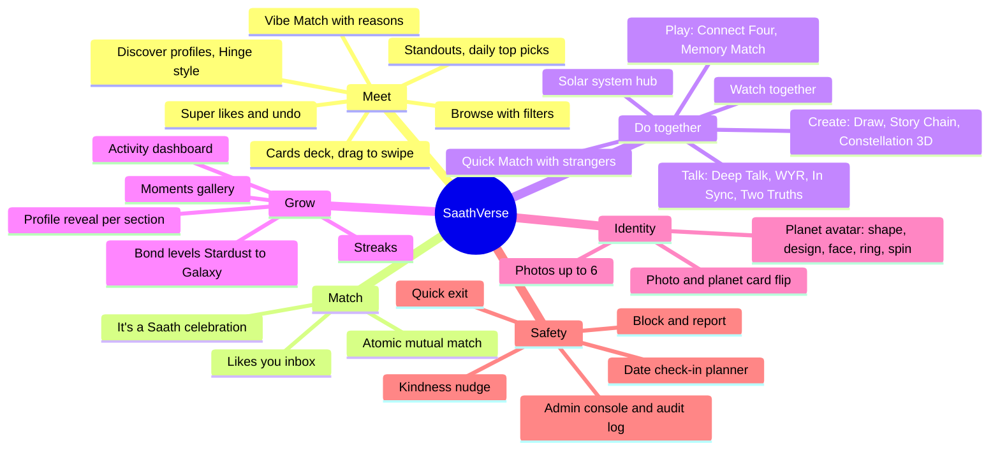
</details>

| Area | Highlights |
| --- | --- |
| 🧭 **Discover** | Three views: **Profiles** (vertical, Hinge-style; like a photo or prompt with a comment), **Cards** (drag gestures, LIKE/NOPE stamps, keyboard shortcuts, undo) and **Browse** (age, intent, gender, city, interests, minimum vibe, online now) |
| ⭐ **Standouts** | Today's single "Most compatible" plus top picks from the ranked pool |
| 💌 **Likes** | Likes you · Matches · Sent; super likes first; "Like back" makes an instant match |
| 💬 **Matches** | Real-time chat with typing indicators, reactions, icebreakers from shared interests, a kindness nudge and a safety tip when contact details are shared |
| 🪐 **Together** | A small **solar system**: four worlds orbit you; pick one and its activities appear as moons; then choose who with (a match, Quick Match, an open table or an invite code) |
| 🎮 **Rooms** | "The space between you": two planets drift closer as the bond grows, every shared moment lights a star, the chat is docked, and 10 server-authoritative live activities |
| 📈 **Activity** | Question of the day, profile completeness, streaks, "your universe" orbit, weekly chart, most-loved activities |
| 🪞 **Profile** | Up to 6 photos, prompts, lifestyle, Vibe Quiz, planet builder, and "preview as a stranger, a connection or a bond level" |
| 🛡️ **Safety and admin** | Report queue with opt-in evidence, pause/ban/restore, masked emails, audit log, analytics |
| ♿ **Accessibility** | AA contrast in both themes, keyboard support, screen-reader labels and data tables, reduced-motion versions of every animation |
| 🎓 **Onboarding** | Gesture coach hints (an animated hand shows swipe, like, tap a world, scroll) on first visit or after a long pause |

---

## 🧬 What makes it novel

1. **The bond is a product surface, not a statistic.** Points come only from things you did together (moments, answers, messages, days active). Five levels unlock profile sections, so trust is *earned and visible*.
2. **Photo and planet, two sides of one person.** Every photo is a card with the member's planet on the back. It flips on hover (and on Discover when you're idle), which softens photo-first judgement and adds personality.
3. **Explainable compatibility.** Vibe Match is a weighted, privacy-aware score that always returns human-readable reasons. There's no black box.
4. **A match starts with an activity, not a chat box.** The shared space opens with games and questions personalised to shared interests.
5. **A spatial interface.** Together is a navigable solar system, and the room visualises "the space between you" as distance plus a constellation of shared moments.
6. **Safety and privacy by design.** City-level distance only (never GPS), privacy per section, kindness nudges, and moderation without reading private chats.

---

## 🧰 Tech stack and justification

| Layer | Choice | Why we chose it |
| --- | --- | --- |
| Web framework | **Next.js 16** (App Router) + **React 19** | Server rendering for the marketing pages and SEO, file-based routing, image and font optimisation, same-origin API proxy |
| Language | **TypeScript** (strict) end to end | One type system across frontend and backend, which catches contract drift at compile time |
| Styling | **Tailwind CSS v4** with design tokens | One token set powers light and dark themes; utilities keep components consistent |
| 3D and motion | **three.js / @react-three/fiber**, SVG + CSS | Rich visuals with no heavy animation runtime; every animation respects reduced motion |
| API | **Express 5** | Small, well understood, easy to audit and extend |
| Real time | **Socket.IO 4** | Rooms, acknowledgements, reconnection and fallbacks out of the box |
| Database | **SQLite (better-sqlite3, WAL)** | Zero-ops, ACID, synchronous transactions (which make the atomic match logic trivial to reason about); the path to Postgres is documented |
| Validation | **Zod 4** | The same schemas validate requests and produce field-level error messages |
| Auth | **JWT in httpOnly cookies** + **bcrypt** | No tokens readable by JavaScript; short-lived socket tickets |
| Hardening | **Helmet**, **express-rate-limit**, CORS allow-list | Secure headers, abuse protection, a strict origin policy |
| Testing | **Vitest**, **Supertest**, **Testing Library**, **Playwright** | Unit, integration, real-socket and real-browser end-to-end coverage |

---

## 🏗️ System architecture (HLD)

<details open>
<summary><b>▶ Show / hide: full system architecture</b></summary>

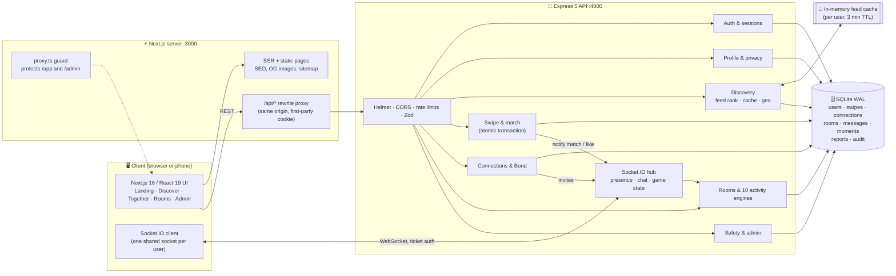
</details>

<details>
<summary><b>▶ Show / hide: service responsibilities</b></summary>

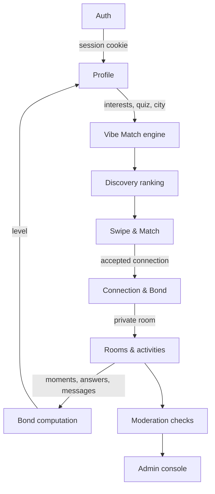
</details>

**Architectural decisions:**
- **A modular monolith.** Each domain (auth, discovery, swipe, rooms, safety) has its own routes, logic and tables, so any of them can be split into a service later without a rewrite.
- **A same-origin API.** The browser only talks to `/api/*` on the web origin, and Next.js rewrites it to the API. Cookies stay first-party, and CORS is never relaxed.
- **Server-authoritative games.** Every activity is a pure `init / reduce / view` module on the server; clients only send intents, so games can't be cheated and stay in sync.
- **Consistency where it matters.** Swipes and matches are strongly consistent (in a transaction); feeds are eventually consistent (cached), the same split large dating systems use.

---

## 🔁 Core flows

<details open>
<summary><b>▶ Show / hide: swipe → like → atomic match</b></summary>

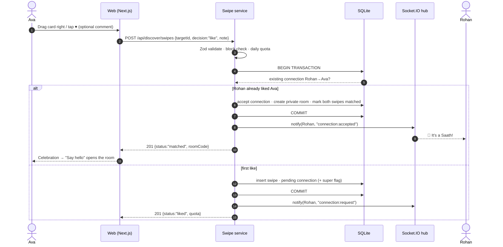
</details>

<details>
<summary><b>▶ Show / hide: Discover feed ranking pipeline</b></summary>

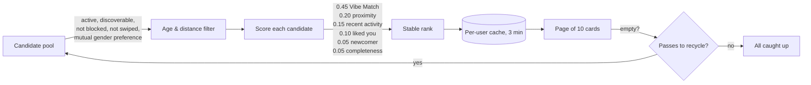
</details>

<details>
<summary><b>▶ Show / hide: Together → room → bond growth</b></summary>

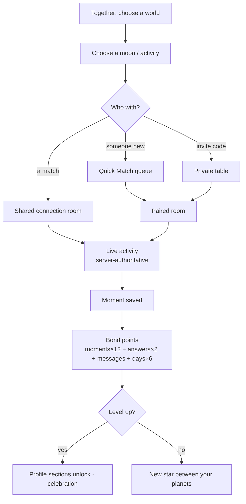
</details>

<details>
<summary><b>▶ Show / hide: authentication and socket ticket</b></summary>

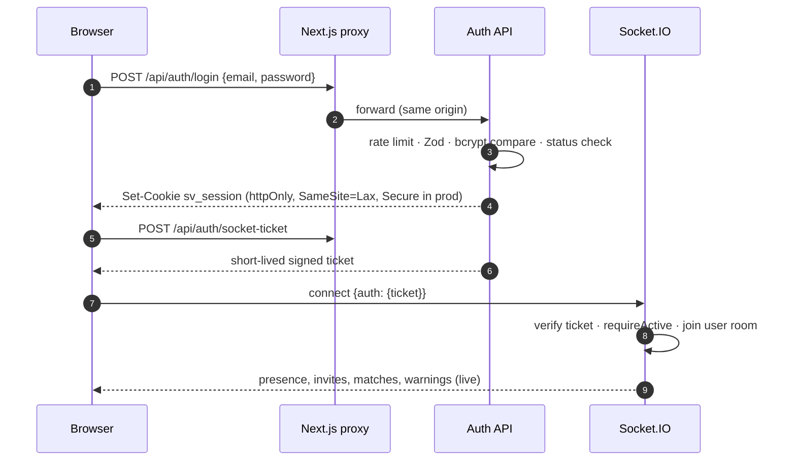
</details>

<details>
<summary><b>▶ Show / hide: moderation and safety flow</b></summary>

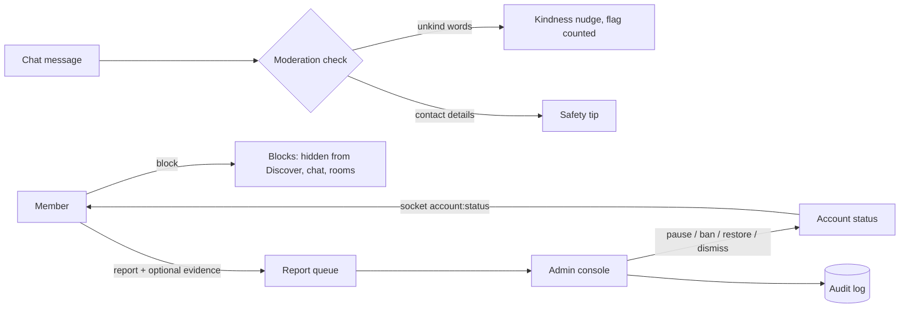
</details>

<details>
<summary><b>▶ Show / hide: member journey state machine</b></summary>

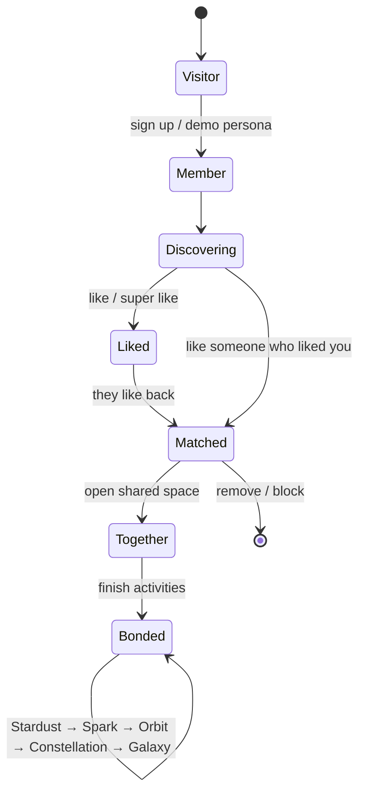
</details>

---

## 🔬 Low level design (LLD)

<details>
<summary><b>▶ Show / hide: backend module diagram</b></summary>

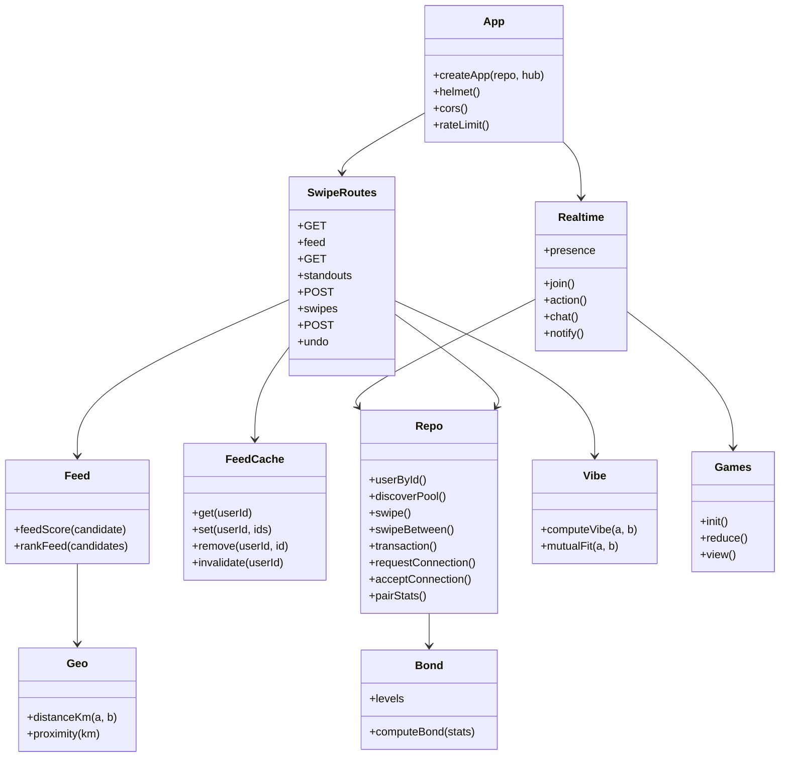
</details>

<details>
<summary><b>▶ Show / hide: frontend component architecture</b></summary>

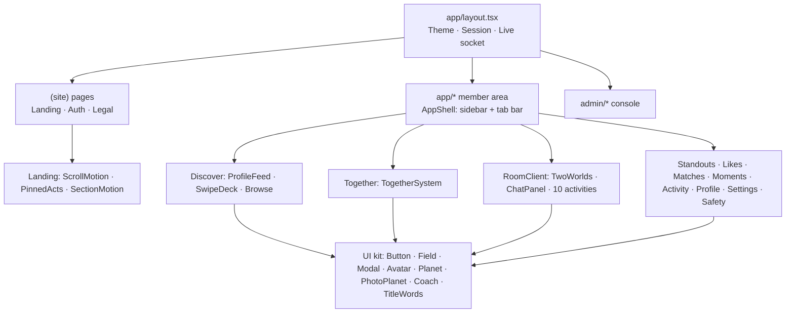
</details>

**Key algorithms (pure and unit tested):**

| Module | Responsibility |
| --- | --- |
| `vibe.ts` | Vibe Match from 0 to 100: interests 30, intent 20, quiz 20, lifestyle 15, social energy 5, love language 5, city 5. Only parts both people answered count, and the weights rescale. Returns parts and reasons. |
| `feed.ts` | Weighted ranking plus a per-user TTL cache (in production this becomes a Redis list) |
| `geo.ts` | City-centre haversine distance; never stores precise location |
| `bond.ts` | Points: moments ×12, answers ×2, messages (capped), active days ×6. Levels at 0, 30, 90, 200 and 400. Streaks count consecutive days. |
| `games/*` | 10 reducers: Deep Talk, Would You Rather, In Sync, Two Truths and a Lie, Connect Four, Memory Match, Draw Together, Story Chain, Constellation, Watch Together |

Full detail: [docs/HLD.md](docs/HLD.md) · [docs/LLD.md](docs/LLD.md) · [docs/ARCHITECTURE.md](docs/ARCHITECTURE.md)

---

## 🗃️ Data model

<details>
<summary><b>▶ Show / hide: entity relationship diagram</b></summary>

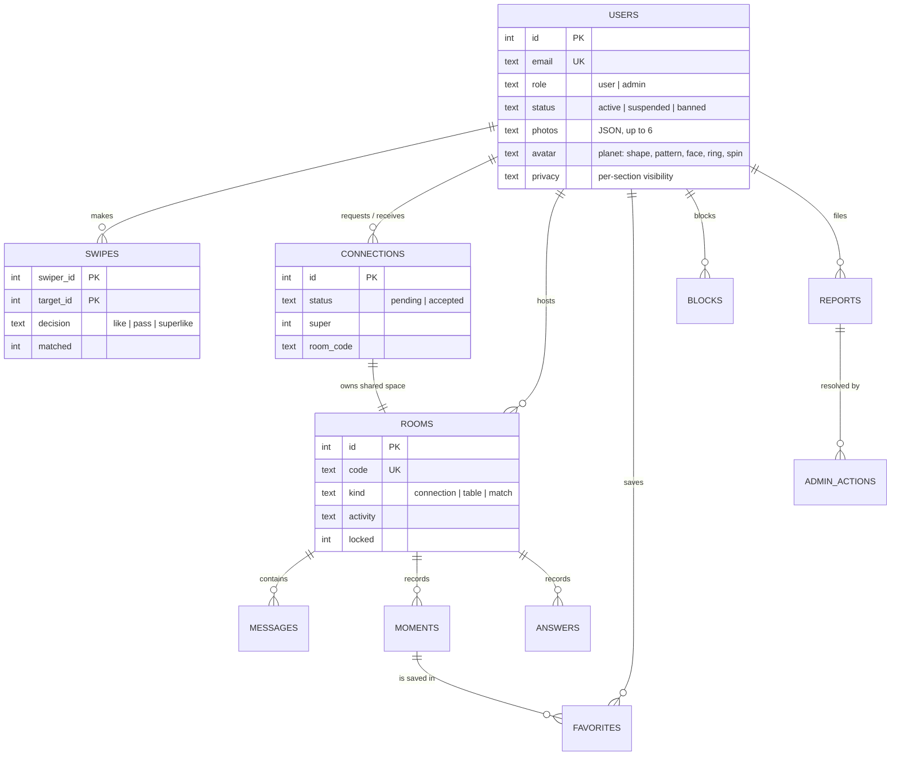
</details>

---

## 📡 API reference

All endpoints live under `/api`. Responses are JSON. Authenticated routes need the `sv_session` cookie.

<details open>
<summary><b>▶ Show / hide: API map</b></summary>

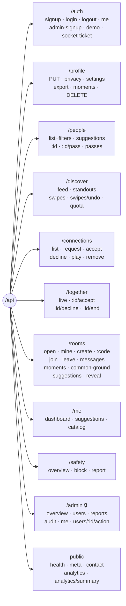
</details>

<details>
<summary><b>▶ Show / hide: full endpoint table</b></summary>

| Group | Method | Endpoint | Purpose |
| --- | --- | --- | --- |
| Auth | POST | `/auth/signup` · `/auth/login` · `/auth/logout` | Account lifecycle (rate limited, honeypot, fill-time check) |
| | POST | `/auth/admin-signup` | Admin account with an invite code |
| | GET · POST | `/auth/demo` | List demo personas · sign in as one `{as, key}` |
| | GET | `/auth/me` | Current session (200 with `user: null` when signed out) |
| | POST | `/auth/socket-ticket` | Short-lived ticket for the WebSocket |
| Profile | PUT | `/profile` · `/profile/privacy` · `/profile/settings` | Save profile (photos, prompts, planet), visibility, preferences |
| | GET · DELETE | `/profile/export` · `/profile` | Data export (GDPR-style) · delete account |
| | GET · POST | `/profile/moments` · `/profile/moments/:id/favorite` | Moments gallery |
| People | GET | `/people?minAge&maxAge&intent&gender&city&interests&minVibe&online&sort&q` | Browse with filters |
| | GET · POST | `/people/:id` · `/people/:id/pass` | Profile as the viewer may see it · pass |
| Discover | GET | `/discover/feed?limit&refresh` | Ranked, cached stack (recycles passes when empty) |
| | GET | `/discover/standouts` | Most compatible today + top picks |
| | POST | `/discover/swipes` `{targetId, decision, note}` | Like / pass / super like; atomic match |
| | POST · GET | `/discover/swipes/undo` · `/discover/swipes/quota` | Undo last pass · remaining likes |
| Connections | GET · POST | `/connections` | Matches, incoming, sent · send a request |
| | POST | `/connections/:id/accept` · `/decline` · `/play` | Respond · open an activity in the shared space |
| Together | GET · POST | `/together/live` · `/together/:id/accept` · `/decline` · `/end` | Live "do something together" invitations |
| Rooms | GET · POST | `/rooms/open` · `/rooms/mine` · `/rooms` | Open tables · yours · create |
| | GET · POST · PUT | `/rooms/:code`, `/join`, `/leave`, `/messages`, `/moments`, `/common-ground`, `/suggestions`, `/reveal` | Room lifecycle and content |
| Home | GET | `/me/dashboard` · `/me/suggestions` · `/me/catalog` | Activity page data, ideas, option lists |
| Safety | GET · POST · DELETE | `/safety/overview` · `/safety/block` · `/safety/report` · `/safety/block/:id` | Safety centre |
| Admin 🔒 | GET · PUT · POST | `/admin/overview` · `/users` · `/reports` · `/reports/:id` · `/users/:id/action` · `/audit` · `/me` | Moderation and analytics |
| Public | GET · POST | `/health` · `/meta` · `/contact` · `/analytics` · `/analytics/summary` | Health check, site form, consent-based analytics |
</details>

---

## ⚡ Real-time events

<details>
<summary><b>▶ Show / hide: socket event flow</b></summary>

```mermaid
flowchart LR
  subgraph C2S["Client → Server"]
    j[room:join] & ra[room:activity] & ga[game:action] & gr[game:restart]
    cs[chat:send] & ct[chat:typing] & re[reaction] & mj["match:join {activity, locked}"] & ml[match:leave]
  end
  HUB((Socket.IO hub))
  subgraph S2C["Server → Client"]
    sn[room:snapshot] & rc[room:changed] & cl[room:closed] & pr[presence]
    cm[chat:message] & ty[chat:typing] & rx[reaction] & mf[match:found]
    cr[connection:request] & ca[connection:accepted] & ri[room:invite]
    aw[account:warning] & as[account:status]
  end
  C2S --> HUB --> S2C
```
</details>

---

## 🔐 Security

<details>
<summary><b>▶ Show / hide: defence-in-depth diagram</b></summary>

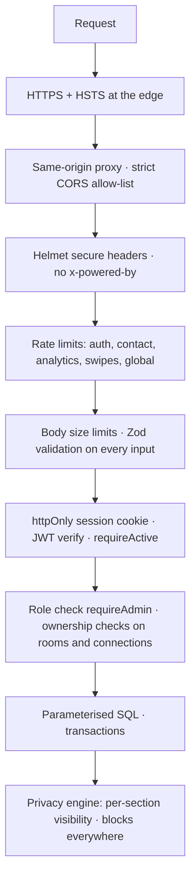
</details>

| Threat | Mitigation |
| --- | --- |
| Credential theft / XSS token leakage | Sessions in **httpOnly**, `SameSite=Lax` cookies (`Secure` in production); no tokens in JavaScript |
| Brute force and spam | `express-rate-limit` on login, sign-up, contact, analytics and swipes; honeypot and minimum fill time on forms |
| Injection | Parameterised `better-sqlite3` statements; **Zod** schemas on every body and query |
| Broken access control | `requireAuth`, `requireActive` (suspended/banned refused on every request and socket), `requireAdmin`, per-resource ownership checks |
| Race conditions | Swipe and match in one **SQLite transaction**, so a simultaneous mutual like always produces exactly one match (covered by a test) |
| Clickjacking and sniffing | `X-Frame-Options: DENY`, `nosniff`, a strict referrer policy and a permissions policy (camera, mic and geolocation off) |
| Unsafe uploads | Photos limited to `https:` URLs or `data:image/(jpeg|png|webp)`, at most 6, size-capped; `javascript:` and `http:` rejected |
| Privacy | City-level distance only; privacy per section; data export and deletion; admins never read private chats; report evidence only with consent |
| Secrets | Server-only environment variables; `JWT_SECRET` must be 32+ characters in production or the server refuses to start; an end-to-end test checks the JS bundles contain no secrets |

---

## 📐 Quality attributes (ISO 25010)

| Characteristic | How SaathVerse addresses it |
| --- | --- |
| **Functional suitability** | Covers the full journey the brief asks for, from discovery to match to doing things together to bond growth, with safety built in. 10 live activities, games and collaborative creation |
| **Performance efficiency** | Cached ranked feeds, one rAF loop per animation, transform-only motion, lazy images, viewport-fit pages, synchronous SQLite in WAL mode |
| **Compatibility** | Works in modern Chromium, Firefox and Safari; responsive from 360px phones to 1920px desktops; light and dark |
| **Usability** | One-screen pages for core tasks, Hinge and Tinder patterns people already know, gesture coach hints, explainable scores |
| **Reliability** | Server-authoritative game state, socket reconnection, transactions, idempotent swipes (primary-key upsert) |
| **Security** | See [Security](#-security) |
| **Maintainability** | A modular monolith with pure, tested domain modules; one design-token file; shared UI kit; strict TypeScript and ESLint; 181 automated tests; documented HLD and LLD |
| **Portability** | Pure Node and npm; runs on macOS, Windows and Linux; environment-driven configuration; deploys to any Node host plus Vercel |
| **Accessibility** | WCAG AA contrast, keyboard navigation, ARIA roles, screen-reader data tables for charts, reduced-motion support everywhere |

---

## ⚡ Quick start

> Requires **Node.js 20+** (22 LTS recommended) and **npm 10+**.

```bash
git clone https://github.com/svj31/connect-experience.git
cd connect-experience
npm run setup     # installs both apps, creates env files with a random JWT secret
npm run demo      # backend on :4000, frontend on http://localhost:3000
```

Open **http://localhost:3000** and press **Try the live demo**, or pick a persona on the sign-in page. The database is created and filled with demo people automatically on first start.

---

## 💻 Installation by OS

<details open>
<summary><b>🍎 macOS</b></summary>

```bash
# 1. Install Node.js 22 LTS (Homebrew), or use the installer from nodejs.org
brew install node@22
# 2. Xcode command line tools (needed to build better-sqlite3 if no prebuilt binary is available)
xcode-select --install
# 3. Clone and run
git clone https://github.com/svj31/connect-experience.git && cd connect-experience
npm run setup && npm run demo
```
</details>

<details>
<summary><b>🪟 Windows 10 / 11</b></summary>

The helper scripts (`setup`, `demo`, `reset-db`) are POSIX shell scripts. Use **Git Bash** (installed with Git for Windows) or **WSL**, or run the steps by hand in PowerShell:

```powershell
# 1. Install Node.js 22 LTS and Git
winget install OpenJS.NodeJS.LTS
winget install Git.Git
# (Only if npm cannot download a prebuilt better-sqlite3:)
# winget install Microsoft.VisualStudio.2022.BuildTools  # include "Desktop development with C++"

# 2. Clone
git clone https://github.com/svj31/connect-experience.git
cd connect-experience

# 3. Install and configure (PowerShell equivalent of npm run setup)
npm install --prefix backend
npm install --prefix frontend
Copy-Item backend\.env.example backend\.env
Copy-Item frontend\.env.example frontend\.env.local
# Put a long random secret in backend\.env  (JWT_SECRET=...)
node -e "console.log(require('crypto').randomBytes(48).toString('hex'))"

# 4. Run in two terminals
npm run dev --prefix backend     # terminal 1  -> http://localhost:4000
npm run dev --prefix frontend    # terminal 2  -> http://localhost:3000
```

From **Git Bash** or **WSL**, `npm run setup && npm run demo` works exactly as on macOS and Linux.
</details>

<details>
<summary><b>🐧 Linux (Ubuntu / Debian / Fedora / Arch)</b></summary>

```bash
# Ubuntu / Debian
curl -fsSL https://deb.nodesource.com/setup_22.x | sudo -E bash -
sudo apt-get install -y nodejs build-essential python3 git
# Fedora:  sudo dnf install nodejs gcc-c++ make python3 git
# Arch:    sudo pacman -S nodejs npm base-devel python git

git clone https://github.com/svj31/connect-experience.git && cd connect-experience
npm run setup && npm run demo
```
</details>

<details>
<summary><b>🧯 Troubleshooting</b></summary>

| Symptom | Fix |
| --- | --- |
| `better-sqlite3` fails to install | Install build tools (Xcode CLT, `build-essential`, or VS Build Tools), then `npm rebuild better-sqlite3 --prefix backend` |
| Port 3000 or 4000 in use | Stop the other process, or set `PORT` in `backend/.env` and update `API_ORIGIN` / `NEXT_PUBLIC_SOCKET_URL` in `frontend/.env.local` |
| Old demo data or no photos | `npm run reset-db`, then restart; demo members also sync automatically on every start |
| Styles look stale in dev | Stop the dev server, delete `frontend/.next`, start again |
| Playwright says browsers are missing | `npx playwright install chromium --prefix frontend` |
</details>

---

## ⚙️ Configuration

| File | Variable | Default | Purpose |
| --- | --- | --- | --- |
| `backend/.env` | `PORT` | `4000` | API port |
| | `JWT_SECRET` | random (created by setup) | Session signing; **32+ characters required in production** |
| | `WEB_ORIGIN` | `http://localhost:3000` | CORS and Socket.IO allowed origin |
| | `DATABASE_PATH` | `./data/saathverse.db` | SQLite file |
| | `ADMIN_INVITE_CODE` | `SAATH-ADMIN-2026` | Needed for admin sign-up; **change it** |
| | `ADMIN_TOKEN` | `change-me` | Reads the analytics summary endpoint |
| | `DEMO_LOGIN` / `SEED_DEMO` | `on` | One-click demo accounts and demo data; **set `off` for a real launch** |
| | `RATE_LIMITS` | (on) | `off` only for local end-to-end runs; ignored in production |
| `frontend/.env.local` | `API_ORIGIN` | `http://localhost:4000` | Server-side proxy target (never exposed to the browser) |
| | `NEXT_PUBLIC_SOCKET_URL` | `http://localhost:4000` | WebSocket endpoint |
| | `NEXT_PUBLIC_SITE_URL` | `http://localhost:3000` | Canonical URL for SEO and OG images |

---

## 🧪 Testing and quality


<details>
<summary><b>▶ Show / hide: test pyramid</b></summary>

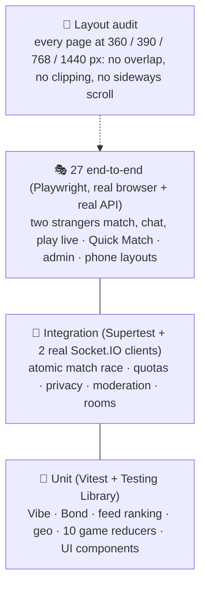
</details>

```bash
npm test                      # backend 116 + frontend 38 = 154 unit/integration tests
npm run typecheck && npm run lint
npm run test:e2e              # 27 Playwright journeys (first time: npx playwright install chromium)
# App already running on 3000/4000? Test a fresh build side by side:
E2E_WEB_PORT=3100 E2E_API_PORT=4100 npm run test:e2e --prefix frontend
BASE_URL=http://localhost:3000 node frontend/tests/layout-audit.mjs
```

More: [docs/TESTING.md](docs/TESTING.md)

---

## 🗂️ Project structure

```
connect-experience/
├── backend/                  Express 5 · Socket.IO · SQLite · Zod
│   ├── src/
│   │   ├── routes/           auth · people · swipes · together · rooms · admin · misc
│   │   ├── games/            10 server-authoritative activities
│   │   ├── vibe.ts feed.ts geo.ts bond.ts people.ts moderation.ts personalize.ts
│   │   ├── realtime.ts       Socket.IO hub (presence, chat, game state)
│   │   ├── db.ts repo.ts     schema, in-place migrations, data access
│   │   └── demo.ts           demo personas and seeded history
│   └── test/                 unit, integration, real-socket tests
├── frontend/                 Next.js 16 · React 19 · Tailwind v4 · three.js
│   ├── src/app/              (site) public pages · app/ member area · admin/
│   ├── src/components/       app · room · activities · landing · ui · admin · brand · fx
│   ├── public/planets/       12 animated planet avatars
│   ├── design_components/    source planet artwork
│   ├── scripts/              generate-planets.py
│   └── tests/                unit · e2e (Playwright) · layout-audit.mjs
├── demo_data/                55 demo members (people.json)
├── docs/                     HLD · LLD · architecture · plan · testing · brand · research
├── instructions/             judge walkthrough · admin guide
└── scripts/                  setup · demo · reset-db
```

---

## ☁️ Deployment

SaathVerse is architected for dual-cloud production deployment: **Next.js 16 frontend on Vercel** and **Express 5 + Socket.IO backend on Render**. This topology gives you edge SSR, instant global CDN delivery, persistent WebSockets, and zero cross-origin cookie issues.

<details open>
<summary><b>▶ Show / hide: production topology & traffic flow</b></summary>

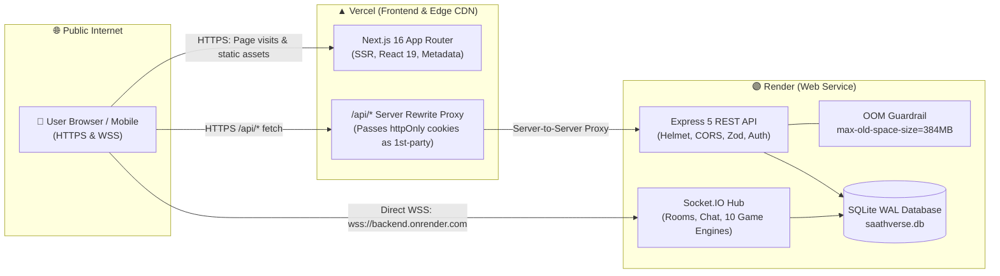
</details>

### 🌟 Why this dual-cloud design works seamlessly

1. **First-Party Cookie Isolation**: The browser only ever makes REST requests to `/api/*` on the Vercel domain. Vercel's Next.js rewrite engine proxies requests server-to-server to Render. Because the browser communicates with a single origin, `httpOnly` `SameSite=Lax` cookies are treated as strictly **first-party**, avoiding Safari ITP, Firefox tracking protection, and Chrome third-party cookie blocking.
2. **Direct WebSockets**: Real-time multiplayer rooms, presence, and chat connect directly to Render via `NEXT_PUBLIC_SOCKET_URL` (`wss://`), bypassing serverless timeout limits.
3. **Free-Tier Stability**: Render's free tier has a 512 MB memory ceiling. With our tuned V8 flags (`--max-old-space-size=384`), memory stays strictly bounded, completely eliminating out-of-memory (OOM) container crashes.

---

### 🟣 Phase 1: Deploy Backend on Render

Deploy the backend first so its live URL is ready for the frontend configuration.

#### 1. Create a New Web Service
1. Log into your [Render Dashboard](https://dashboard.render.com/) and click **New +** → **Web Service**.
2. Connect your GitHub repository: `svj31/connect-experience`.
3. Configure the service settings:
   - **Name**: `saathverse-backend` (or your chosen name)
   - **Region**: Choose closest to your audience (e.g., `Singapore`, `Frankfurt`, or `Oregon`)
   - **Branch**: `main`
   - **Root Directory**: *(leave blank to use repository root)*
   - **Runtime**: `Node`
   - **Build Command**:
     ```bash
     npm install --prefix backend
     ```
   - **Start Command**:
     ```bash
     npm run start --prefix backend
     ```
   - **Instance Type**: **Free** (0.1 CPU, 512 MB RAM)

#### 2. Render Free-Tier OOM Prevention Guardrails (Critical!)
Render's free tier enforces a strict 512 MB cgroup memory cap. By default, Node.js V8 calculates its heap limit from the physical host system (>1.4 GB), causing delayed garbage collection that triggers Render's cgroup killer with `Exit Code 137 (SIGKILL / OOM Killed)`.

To ensure 100% stable, zero-OOM execution, set the following environment variables in Render:

| Variable | Value | Why it's critical |
| --- | --- | --- |
| `NODE_OPTIONS` | `--max-old-space-size=384` | Restricts V8 heap to 384 MB, forcing proactive garbage collection well before the 512 MB container ceiling. |
| `NODE_VERSION` | `20.18.0` | Pins LTS Node with lean baseline memory consumption. |

#### 3. Render Environment Variables
In your Render Web Service settings, navigate to **Environment** and add the following:

| Variable | Recommended / Example Value | Description |
| --- | --- | --- |
| `PORT` | `4000` | Port Express listens on (Render automatically binds to this or assigns `$PORT`). |
| `NODE_ENV` | `production` | Enables production optimizations and disables debug overhead. |
| `NODE_VERSION` | `20.18.0` | Node.js LTS version. |
| `NODE_OPTIONS` | `--max-old-space-size=384` | **OOM guardrail:** Caps V8 heap at 384 MB. |
| `JWT_SECRET` | *(64+ random hex characters)* | Signs user session JWTs. Generate locally with:<br/>`node -e "console.log(require('crypto').randomBytes(48).toString('hex'))"` |
| `WEB_ORIGIN` | `https://your-app.vercel.app` | Allowed CORS & Socket.IO origin (your Vercel frontend domain, **no trailing slash**). |
| `ADMIN_INVITE_CODE` | `SAATH-PROD-2026-SECRET` | Secret token required to register administrative accounts. |
| `ADMIN_TOKEN` | *(strong random string)* | Bearer token for accessing admin analytics export endpoints. |
| `DATABASE_PATH` | `./data/saathverse.db` | Path to SQLite database file. |
| `DEMO_LOGIN` | `on` | Keeps one-click demo personas available for judges. Set `off` for clean public launch. |
| `SEED_DEMO` | `on` | Populates 55 demo members and activity history on start. |
| `RATE_LIMITS` | `on` | Enforces express-rate-limit protection. |

> [!NOTE]
> **Ephemeral SQLite vs Persistent Disk**:
> On Render's Free tier, the filesystem is ephemeral: restarting the service will re-seed fresh demo data from `demo_data/people.json`. This is ideal for hackathon evaluation because judges always get a fresh, working sandbox. For persistent production, attach a **Persistent Disk** mounted at `/var/data` and set `DATABASE_PATH=/var/data/saathverse.db`.

#### 4. Anti-Sleep Keep-Alive Monitor (Free-Tier Optimization)
Render free services sleep after 15 minutes of inactivity. When a judge visits, the first request could face a 50-second cold start.
- **The Solution**: Set up a free uptime monitor at [cron-job.org](https://cron-job.org/) or [UptimeRobot](https://uptimerobot.com/).
- **Target URL**: `https://saathverse-backend.onrender.com/api/health`
- **Schedule**: Every 10 minutes (HTTP GET).
- This keeps the instance hot 24/7 with zero cold starts during demo reviews!

---

### ▲ Phase 2: Deploy Frontend on Vercel

#### 1. Import Project to Vercel
1. Log into your [Vercel Dashboard](https://vercel.com/) and click **Add New...** → **Project**.
2. Select your repository: `svj31/connect-experience`.
3. In the **Configure Project** screen:
   - **Framework Preset**: **Next.js**
   - **Root Directory**: Click **Edit** and select `frontend` (⚠️ **Essential: do not leave at root!**)
   - **Build Command**: `npm run build` (Turbopack production build)
   - **Output Directory**: `.next`
   - **Install Command**: `npm install`

#### 2. Vercel Environment Variables
Add the following under **Environment Variables** in the Vercel project configuration:

| Variable | Example Value | Purpose |
| --- | --- | --- |
| `API_ORIGIN` | `https://saathverse-backend.onrender.com` | Target URL for server-side Next.js `/api/*` rewrite proxy (**no trailing slash**). |
| `NEXT_PUBLIC_SOCKET_URL` | `https://saathverse-backend.onrender.com` | Public WebSocket endpoint for real-time multiplayer rooms (**no trailing slash**). |
| `NEXT_PUBLIC_SITE_URL` | `https://your-app.vercel.app` | Canonical site URL for SEO, meta tags, and OpenGraph social preview cards. |

Click **Deploy**. Vercel will build the Next.js app and assign your production domain (e.g., `https://connect-experience.vercel.app`).

#### 3. Update Render CORS
Once Vercel assigns your live domain (e.g., `https://connect-experience.vercel.app`), return to Render and ensure `WEB_ORIGIN` matches this exact URL without a trailing slash.

---

### 🛡️ Phase 3: Post-Deployment Verification Checklist

Run through this verification sequence to confirm the entire production pipeline is operational:

| Step | Test | How to Verify | Expected Result |
| :--- | :--- | :--- | :--- |
| **1. API Health** | Backend liveness | `curl https://<backend>.onrender.com/api/health` | HTTP 200 with JSON: `{"status":"ok","uptime":...}` |
| **2. SSR & CDN** | Frontend landing | Open `https://<frontend>.vercel.app` in browser | Instant render with dark/light theme, interactive preview, status 200 |
| **3. First-Party Auth** | Persona login | Click "Sign in" → Click **👩 Ava** persona | Immediate login; browser receives `token` cookie (`httpOnly; SameSite=Lax`) on the Vercel domain |
| **4. Discovery & Swipes** | Discovery feed | Navigate to `/app/discover` | Cards load with photos, vibe reasons, and interactive 3D PhotoPlanet flip |
| **5. WebSockets** | Real-time presence | Open browser DevTools → Network → WS | Connection to `wss://<backend>.onrender.com/socket.io/` established (HTTP 101 Switching Protocols) |
| **6. Multiplayer Room** | Live games | Open Together room in two browser windows | Chat messages, typing indicators, and Connect Four / Memory Match moves synchronize instantaneously |
| **7. Admin Console** | Moderation & audit | Log in as `admin@saathverse.test` → Visit `/admin` | System statistics, report queue, and live audit log render properly |

---

## 🛣️ Roadmap

- [x] Swipe, like-with-comment, atomic match, quotas, undo, super likes
- [x] Ranked and cached Discover feed, Standouts, city distance
- [x] 10 live activities, Together solar system, rooms with docked chat
- [x] Bond levels with progressive profile reveal; photo and planet identity
- [x] Safety centre, moderation console, audit log
- [x] Accessibility, light and dark, responsive layouts, gesture onboarding
- [ ] Public deployment and demo video (final round)
- [ ] Photo verification and a verified badge
- [ ] Voice and video rooms (WebRTC) unlocked at higher bond levels
- [ ] Postgres + Redis (Socket.IO adapter, feed precompute, geohash sharding)
- [ ] Push notifications and scheduled dates; Hindi and regional languages

---

## 📚 Documentation index

| Document | What's inside |
| --- | --- |
| [docs/HLD.md](docs/HLD.md) | Requirements, services, research-to-decision table, scaling path |
| [docs/LLD.md](docs/LLD.md) | Module internals, transaction pseudo-code, data, UI interactions |
| [docs/ARCHITECTURE.md](docs/ARCHITECTURE.md) | Runtime architecture, algorithms, API and socket reference |
| [docs/PLAN.md](docs/PLAN.md) | Version-by-version build log and design decisions |
| [docs/TESTING.md](docs/TESTING.md) | Test suites, layout audit, issues found and fixed |
| [docs/SUMMARY.md](docs/SUMMARY.md) | One-page project summary for judges |
| [docs/brand/README.md](docs/brand/README.md) | Logo, colour tokens, type, planet system |
| [instructions/JUDGE_WALKTHROUGH.md](instructions/JUDGE_WALKTHROUGH.md) | A 5-minute guided tour |
| [instructions/ADMIN_GUIDE.md](instructions/ADMIN_GUIDE.md) | Moderation guide |
| [SETUP_INSTRUCTIONS.md](SETUP_INSTRUCTIONS.md) | Extended setup notes |

---

<div align="center">

**SaathVerse:** because the best first dates start with *doing something together*.

Made with 💜 for **AFFECIO HACKS '26**

</div>
